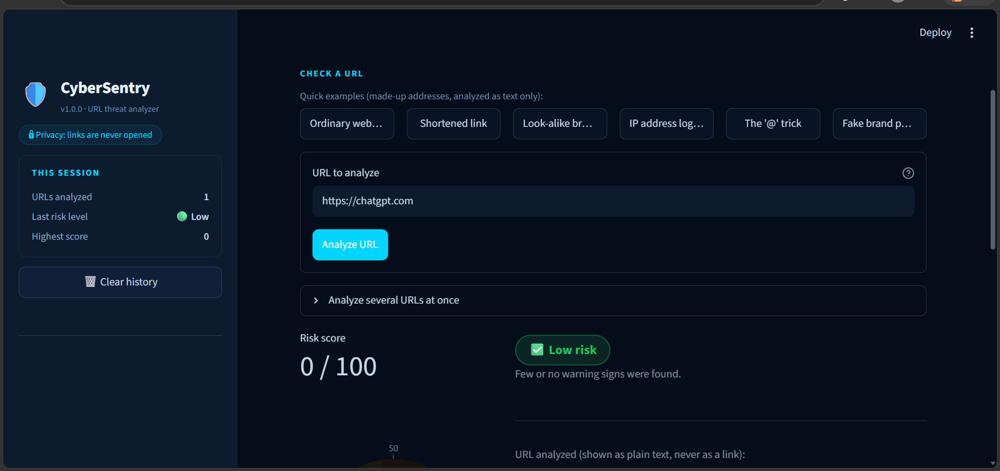
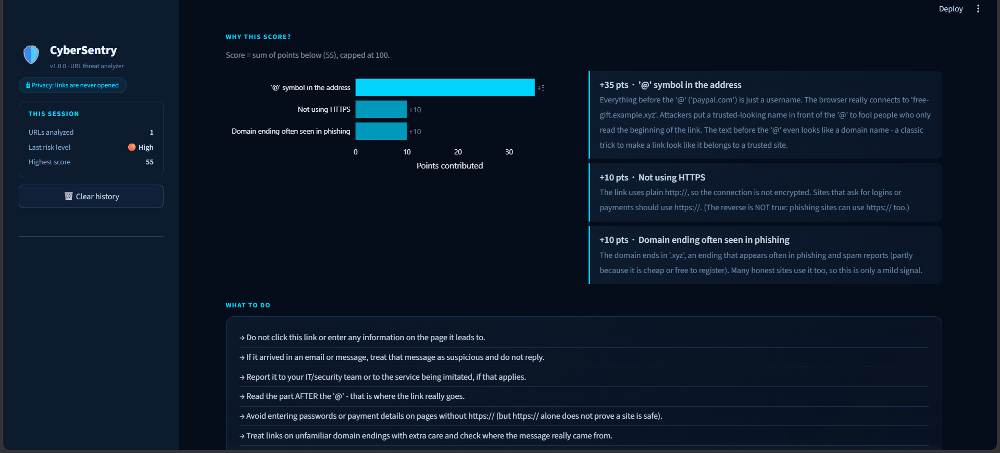
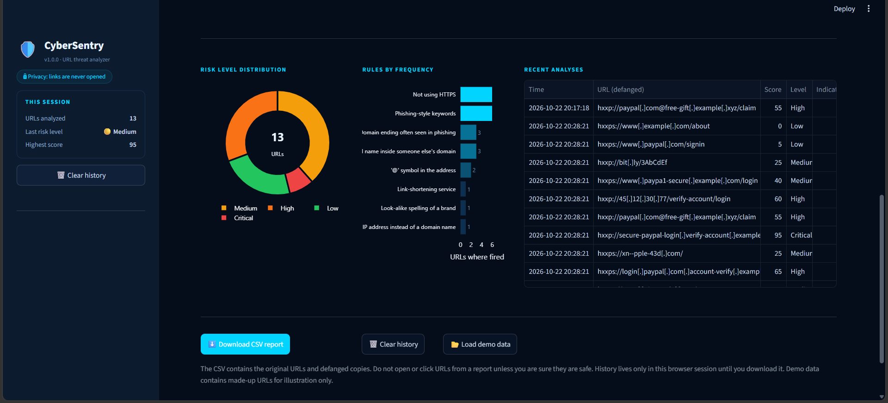
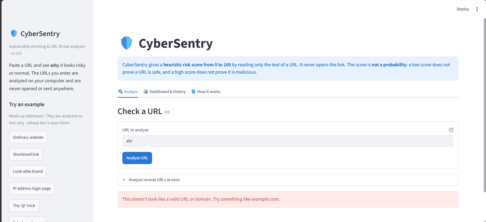

# 🛡️ CyberSentry - Explainable Phishing & Security Threat Analyzer

CyberSentry reads the **text of a URL** and tells you **why** it looks risky or normal. Instead of a
mysterious "safe / dangerous" label it gives a **transparent 0-100 heuristic risk score**, lists every
indicator that fired with its points and a plain-English reason, and suggests what to do next.

> **Important:** the score is a *heuristic*, **not a probability**. A low score does **not** guarantee a URL is
> safe, and a high score does **not** prove it is malicious. See [Limitations](#limitations).

Built by **Anannya AK** for the **IBM SkillsBuild Cyber Security 2026** bootcamp (conducted by BharatCares).

## Screenshots

**Low-risk result:** every indicator is explained, and the wording says a low score does not prove safety.



**High-risk result:** each indicator that fired is listed with its points and a plain-English reason.



**Session history and charts:**



**Error handling:** invalid input is rejected with a clear message.



## Features

- URL input and **validation** (only http/https, no spaces or hidden characters, size limit, sane host and port)
- **16 rule-based detections**: IP-address hosts (even disguised ones), `@` tricks, long URLs, excessive subdomains,
  phishing keywords, brand impersonation, look-alike spellings (`paypa1`, `rnicrosoft`), punycode/Unicode hosts,
  plain HTTP, hyphen chains, suspicious domain endings, link shorteners, odd ports, hidden redirects, risky file types
- **Explainable score** (0-100): the sum of the points of the rules that fired, capped at 100
- Risk levels (Low / Medium / High / Critical), per-indicator explanations and recommendations
- Interactive **Streamlit dashboard**: session history, summary metrics, Plotly charts
- **Batch mode** (up to 25 URLs at once)
- **CSV export** of the session history (with CSV-injection protection)
- Error handling and **115 automated tests**

## Technologies used

- Python 3.10+
- [Streamlit](https://streamlit.io/) (dashboard)
- [Pandas](https://pandas.pydata.org/) (history table and CSV export)
- [Plotly](https://plotly.com/python/) (charts and risk gauge)
- Python standard library: `urllib.parse` (URL parsing), `ipaddress` (IP-address detection), `html`
- [pytest](https://pytest.org/) (automated tests)
- VS Code, Git and GitHub; IBM Bob as the coding assistant

## Dataset

CyberSentry uses **no external dataset**. It is a rule-based analyzer, not a machine-learning model, so nothing is
trained and no data is downloaded. The URLs used for demonstration and testing are made-up or well-known examples
listed in [docs/TEST_URLS.md](https://github.com/Anannyaa97/CyberSentry/blob/main/docs/TEST_URLS.md), together with the
score each one produces. The brand and keyword lists are small demo lists stored in `cybersentry/config.py`.

## Quick start (Windows + PowerShell)

You need Python 3.10 or newer ([python.org](https://www.python.org/downloads/)) and, optionally, Git.

```powershell
# 1. Get the project (or download the ZIP from GitHub and unzip it), then go into the folder
git clone https://github.com/Anannyaa97/CyberSentry.git
cd CyberSentry

# 2. Create a virtual environment (a private box for this project's libraries)
python -m venv .venv

# 3. Activate it (your prompt will start with (.venv))
.\.venv\Scripts\Activate.ps1

# 4. Install the libraries
python -m pip install --upgrade pip
pip install -r requirements.txt

# 5. Start the app (a browser tab opens at http://localhost:8501)
streamlit run app.py
```

Stop the app with **Ctrl + C** in the terminal. If Streamlit asks for an e-mail address the first time, just press Enter.

### Troubleshooting

| Problem | Fix |
|---|---|
| `Activate.ps1 cannot be loaded because running scripts is disabled` | Run `Set-ExecutionPolicy -Scope CurrentUser -ExecutionPolicy RemoteSigned`, answer `Y`, then repeat step 3. Or skip activation and use `.\.venv\Scripts\python.exe -m pip install -r requirements.txt` and `.\.venv\Scripts\python.exe -m streamlit run app.py`. |
| `pip install` fails with a build/compile error | Your Python may be too new for a library. Install Python 3.12 or 3.13 and create the environment with `py -3.12 -m venv .venv`. |
| `streamlit` is not recognized | The virtual environment is not active. Repeat step 3, or use `python -m streamlit run app.py`. |
| Port 8501 is busy | `streamlit run app.py --server.port 8502` |

## Run the tests

```powershell
python -m pytest
```

You should see `115 passed` (the exact number grows if you add tests). The tests cover input validation, every
rule, score boundaries, CSV export and the dashboard itself (using Streamlit's built-in `AppTest`, no browser needed).

## Input validation

Input is checked **before** any analysis. The validator rejects, with a clear message:

- empty input, spaces or hidden/control characters, and over-long input
- anything that is not `http://` or `https://`
- hosts that are not a valid domain or IP address, such as `abc` or `localhost` (single words with no domain ending)
- invalid ports

Rejected input is never analyzed and never echoed back unsafely.

## Project structure

```
CyberSentry/
├── app.py                  # The Streamlit dashboard (screen + session history)
├── requirements.txt        # streamlit, pandas, plotly, pytest
├── cybersentry/
│   ├── config.py           # ALL numbers and word lists: points, keywords, brands, risk bands
│   ├── validator.py        # Validates input and parses the URL (urllib.parse + ipaddress)
│   ├── rules.py            # The 16 detection rules (one small function each)
│   ├── analyzer.py         # Runs the rules, adds the score, picks the level and advice
│   └── report.py           # DataFrame, summary numbers, CSV export, safe text
├── tests/                  # Automated tests (pytest)
├── docs/                   # Presentation outline, test URLs, IBM Bob prompts, checklists, screenshots
└── .streamlit/config.toml  # Usage statistics off, theme colour
```

The backend (`cybersentry/`) does not depend on Streamlit, so the same logic could be reused later behind a web API.

One file = one job. If you want to change *how many points* a rule gives, edit `config.py`.
If you want to change *what a rule detects*, edit `rules.py`.

## How the score works

```
score = min(100, sum of the points of every rule that fired)
```

| Score | Level |
|---|---|
| 0 - 19 | Low |
| 20 - 44 | Medium |
| 45 - 69 | High |
| 70 - 100 | Critical |

These levels are **heuristic bands, not probabilities**.

| Rule | Looks for | Max points |
|---|---|---|
| IP host | IP address (or a disguised number) instead of a domain name | 35 |
| `@` symbol | Text before `@` that the browser treats as a username | 35 |
| Brand impersonation | Brand name inside someone else's domain (+ real domain used as a decoy) | 40 |
| Look-alike spelling | `paypa1`, `g00gle`, `rnicrosoft` | 30 |
| Punycode / Unicode | `xn--` names or letters from other alphabets | 25 |
| Subdomains | 3+ / 5+ levels in front of the main domain | 20 |
| URL length | 75 / 100 / 200+ characters | 15 |
| Keywords | login, verify, secure, account... (5 each, capped) | 15 |
| Link shortener | bit.ly, tinyurl.com ... | 15 |
| No HTTPS | plain `http://` | 10 |
| Hyphens | 2 / 3+ hyphens in the host | 10 |
| Suspicious ending | `.xyz`, `.top`, `.zip` ... | 10 |
| Unusual port | anything except 80 / 443 | 10 |
| Embedded URL | another `http://` hidden in the path/query | 10 |
| Brand in path | brand name only after the domain | 10 |
| Risky file type | `.exe`, `.scr`, `.apk`, `.zip` ... | 10 |

Example inputs with their real scores are in [docs/TEST_URLS.md](docs/TEST_URLS.md).

## Security design

CyberSentry is a security tool, so it treats its own input carefully:

- **It never visits a submitted URL** and sends no URL to any external service - it only reads characters.
- **Input is untrusted**: length limit, strict validation, no echoing of bad input in error messages.
- URLs are shown as **plain text** (never links) and are **escaped** before display (`html.escape` inside HTML blocks), so Markdown or HTML such as `` cannot trigger a request.
- Reports contain **defanged** URLs (`hxxp://example[.]com`) so nobody clicks them by accident.
- The CSV export neutralizes cells starting with `=`, `+`, `-`, `@` (**CSV/formula injection**).
- Streamlit's anonymous usage statistics are switched off in `.streamlit/config.toml`.
- History is kept in memory for the browser session only; nothing is written to disk unless you download the CSV.

Note: Streamlit itself is a web framework. While testing in headless mode its own startup tried to look up the machine's public IP address;
that is unrelated to the URLs you analyze, which never leave the analyzer.

## Limitations

Heuristic rules are simple pattern checks. They are useful for learning and quick triage, but they are **not** a replacement for
browser protection, e-mail security gateways, threat-intelligence feeds or human judgment.

- **False negatives (a low score on something bad):** a brand-new phishing domain with no suspicious words scores 0; a hacked legitimate
  website looks legitimate; a short link hides its destination (and we never open links); brands outside the demo list are not recognized.
- **False positives (a high score on something harmless):** a shop named *pineapple* matches the brand *apple*; honest sites use long tracking
  links, redirects, hyphens, `.xyz` domains and international characters. A real Zoom recording link scored 25 (Medium) in our own testing.
- Only the **URL text** is analyzed - not the page content, the sender, the domain age, TLS certificates or reputation.
- The brand list covers only a small demo set of 23 brands.
- The "main domain" is found with a small built-in list of two-part endings (like `co.uk`), not the full Public Suffix List.
- Attackers who know these rules can avoid them. The brand list and keyword lists are small demo lists.

Some of these limitations are documented as tests (`test_known_false_positive_...`, `test_known_false_negative_...` in `tests/test_analyzer.py`).

## Extending the project

1. Write a `check_...()` function in `rules.py` that returns an `Indicator` or `None`.
2. Add its points to `POINTS` in `config.py`.
3. Add a `Rule(...)` entry to `RULES`.
4. Add a test in `tests/test_analyzer.py` and run `python -m pytest`.

Ideas: more brands (add to `BRANDS`), digit-ratio rule, `data:` URI detection, a PDF report, a web API reusing the backend,
an optional offline log analyzer. Machine learning, threat-intelligence APIs and a database were intentionally left out of v1.

## AI assistance disclosure

This project was developed with the help of AI assistants (IBM Bob as the coding assistant, plus AI tools for planning and
learning). The author reviewed the code, ran the test suite and can explain every module.

## License

Educational project created for the IBM SkillsBuild Cyber Security 2026 bootcamp.